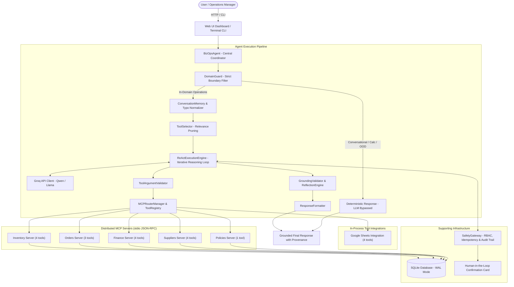

# BizOps Agent — Small Business Operations Assistant

> **An Agentic AI Operations Assistant for wholesale distributors and small-to-medium enterprises, engineered with custom ReAct orchestration, five independent Model Context Protocol (MCP) servers, Groq LPU inference, human-in-the-loop safety governance, and hybrid Google Sheets tool calling.**

---

## 1. Project Overview

**BizOps Agent** is a domain-specialized, autonomous AI operations assistant built to streamline small and medium enterprise (MSME) distribution workflows. In wholesale environments—such as FMCG, electronics, and hardware distribution—operational data is routinely fragmented across godown inventories, sales order logs, accounting ledgers, and shared spreadsheets. BizOps Agent unifies these operations under a single, natural-language interface. Instead of acting as a passive retrieval bot, BizOps Agent autonomously reasons over user requests, retrieves live relational records and spreadsheet data via standardized MCP tools, computes business metrics deterministically, and requires explicit human approval before staging purchase orders or mutating state.

---

## 2. Key Features

- **Agentic AI & Custom ReAct Orchestration:** Implements an iterative Thought-Action-Observation reasoning loop (`ReActExecutionEngine`) without third-party agent wrapper frameworks.
- **Five Independent MCP Servers:** Complete domain isolation across five dedicated subprocess servers communicating via standard input/output (`stdio`) JSON-RPC 2.0.
- **20 Registered Tools:** Comprehensive coverage across stock checks, order investigations, credit balances, supplier rankings, operational policies, and Google Sheets data.
- **Dynamic Tool Selection:** Intent-driven tool candidate filtering (`ToolSelector`) prunes the active schema context down to relevant tools, minimizing latency and eliminating LLM tool confusion.
- **Multi-Turn Conversational Memory:** Short-term sliding-window memory (`ConversationMemory`) tracks session state, resolves follow-up questions, and normalizes input typos.
- **Deterministic Business Calculations:** Business math (available stock, credit limits, outstanding balances, supplier ranking) is calculated in Python using `decimal.Decimal`, completely bypassing LLM arithmetic.
- **Strict Domain Boundary (`DomainGuard`):** High-speed deterministic pre-filter catches conversational greetings, arithmetic queries, and out-of-domain questions in under 1 ms without consuming LLM tokens.
- **Grounded Responses & Reflection:** Pre-execution schema checking (`ToolArgumentValidator`), post-execution observation fact verification (`GroundingValidator`), and self-reflection quality scoring (`ReflectionEngine`).
- **Human-in-the-Loop (HITL) Safety:** Two-phase commit mechanism (`SafetyGateway`) stages write actions with unique IDs and interactive confirmation cards before executing state changes.
- **RBAC & Audit Logging:** Role-based access control (`Operator`, `Manager`, `Admin`), SHA-256 parameter idempotency hashing to prevent duplicate transactions, and immutable SQLite audit logging.
- **SQLite Persistence:** Embedded SQLite 3 database operating in Write-Ahead Logging (`WAL`) mode with foreign key integrity.
- **Hybrid Google Sheets Integration:** Tool-callable spreadsheet integration supporting both real Google Cloud Sheets API v4 and an authentic in-memory Indian MSME demo store with zero silent mock fallbacks.

---

## 3. Architecture



---

## 4. Technology Stack

| Layer | Component | Version / Specification | Purpose |
|---|---|---|---|
| **Language** | Python | 3.11+ | Core runtime environment |
| **Backend Framework** | FastAPI / Uvicorn | `fastapi==0.138.2`, `uvicorn==0.49.0` | Asynchronous ASGI REST API and dashboard server |
| **Frontend UI** | HTML5 / CSS3 / ES6 | Vanilla JavaScript (SPA) | Responsive dashboard; zero build steps or node dependencies |
| **LLM Inference** | Groq Python SDK | `groq==1.7.0` | High-speed cloud LLM inference (`qwen/qwen3.8-27b`, `llama-3.3-70b-versatile`) |
| **Tool Protocol** | Model Context Protocol | `mcp==1.28.1` | JSON-RPC 2.0 communication over asynchronous standard I/O (`stdio`) |
| **Data Persistence** | SQLite 3 | WAL Mode (Write-Ahead Logging) | ACID-compliant relational data store with foreign keys |
| **Data Validation** | Pydantic / JSONSchema | `pydantic==2.13.4`, `jsonschema==4.26.0` | Structured data models and tool argument validation |
| **Cloud Integration** | Google Client API | `google-api-python-client==2.201.0`, `google-auth==2.55.1` | Google Sheets API v4 integration with mock demo fallback |
| **Testing** | pytest & pytest-asyncio | `pytest==9.1.1`, `pytest-asyncio==1.4.0` | Comprehensive unit, integration, and regression testing |

---

## 5. Project Structure

```text
BizOps Agent/
├── agent/                      # Core agent coordinator, reasoning, and validation
│   ├── __init__.py             # Public module exports
│   ├── agent.py                # BizOpsAgent: Central coordinator & entry point
│   ├── react_loop.py           # ReActExecutionEngine & DeterministicFallbackEngine
│   ├── tool_selector.py        # Dynamic relevance-based tool candidate pruning
│   ├── memory.py               # ConversationMemory: Short-term turns, state & follow-ups
│   ├── domain_guard.py         # DomainGuard: Deterministic business boundary enforcement
│   ├── tool_validator.py       # ToolArgumentValidator & GroundingValidator
│   ├── response_formatter.py   # Structured markdown formatting & provenance stamping
│   ├── reflection.py           # ReflectionEngine: Self-reflection & task evaluation
│   └── observability.py        # Trace logging & credential redaction filters
├── app/                        # Application configuration and ASGI dependencies
│   ├── config.py               # Canonical configuration settings & environment variables
│   └── dependencies.py         # FastAPI request dependencies & security context
├── database/                   # SQLite persistence, migrations, and seed datasets
│   ├── connection.py           # Connection management with WAL mode & row factories
│   ├── migrations.py           # Automated schema migrations
│   ├── models.py               # Pydantic schemas, DB dataclasses & action models
│   ├── schema.sql              # Relational SQL schema definitions
│   ├── seed.py                 # Seed script with realistic wholesale distribution data
│   └── repositories/
│       └── repository.py       # BizOpsRepository: Authoritative SQL repository
├── domain/                     # Entity resolution & fuzzy matching algorithms
│   ├── entity_resolver.py      # Fuzzy matcher for products, customers, and suppliers
│   └── policy_retriever.py     # TF-IDF retrieval engine for operational policies
├── integrations/               # External service integrations
│   └── google_sheets/          # Google Sheets API v4 client & mock demo store
│       ├── client.py           # Authenticated API & fallback sheets client
│       ├── tools.py            # Sheets tool definitions (read, search, update, append)
│       ├── schemas.py          # Sheets validation schemas
│       └── auth.py             # Service account credential loader
├── llm/                        # Large Language Model client and prompt definitions
│   ├── base.py                 # Abstract LLM client interface
│   ├── groq_client.py          # Groq API integration with rate-limit and retry handling
│   ├── prompts.py              # Canonical ReAct and reflection system prompts
│   └── schemas.py              # Structured JSON schemas for model output
├── mcp/                        # Model Context Protocol client & routing layer
│   ├── client.py               # Stdio JSON-RPC client managing subprocesses
│   └── router.py               # MCPRouterManager & unified ToolRegistry
├── mcp_servers/                # Five isolated domain FastMCP servers (stdio JSON-RPC)
│   ├── inventory/server.py     # Inventory MCP server (4 tools)
│   ├── orders/server.py        # Orders MCP server (3 tools)
│   ├── finance/server.py       # Finance MCP server (4 tools)
│   ├── suppliers/server.py     # Suppliers & PO MCP server (4 tools)
│   └── policies/server.py      # Company operational policies MCP server (1 tool)
├── security/                   # Safety Gateway, RBAC, Two-Phase Commit & PII masking
│   ├── safety_gateway.py       # SafetyGateway: Two-Phase Commit, RBAC & Idempotency
│   ├── confirmation.py         # Interactive confirmation card formatter
│   └── redaction.py            # SecuritySanitizer: Secret masking & PII redaction
├── services/                   # Authoritative deterministic business math & services
│   ├── inventory_service.py    # Inventory math, availability & classification
│   ├── order_service.py        # Order fulfillment & shortage investigation
│   ├── finance_service.py      # Outstanding balances, overdue checks & revenue
│   ├── supplier_service.py     # Deterministic landed-cost & supplier ranking
│   ├── date_resolver.py        # Relative business date resolver
│   ├── language_policy.py      # Hinglish/English language detection & persistence
│   └── query_normalizer.py     # Common business typo & spelling normalizer
├── ui/                         # Single-page dashboard (FastAPI backend + HTML5/ES6)
│   ├── app.py                  # Web application server & REST/WebSocket routes
│   └── index.html              # Responsive dashboard interface
├── tests/                      # Automated pytest regression suite (134 tests)
├── data/                       # Operational SQLite database (bizops.db)
├── docs/                       # Operational company policy markdown documents
├── run.py                      # Unified CLI & Web entry point
├── requirements.txt            # Pinned production dependencies
└── README.md                   # Primary project documentation
```

---

## 6. Agent Execution Flow

### Read-Only Query Lifecycle

1. **User Query Submission:** The user submits an operational question via the Web UI or CLI.
2. **Deterministic Domain Classification:** [`DomainGuard`](file:///c:/Users/ArtiJain/Documents/L2%20Project/BizOps%20Agent/agent/domain_guard.py) inspects the query. If the request is non-business trivia (`OUT_OF_DOMAIN`), conversational (`CONVERSATIONAL`), or an arithmetic expression (`BUSINESS_CALCULATION`), a deterministic response is returned immediately, completely bypassing LLM inference.
3. **Session Memory & Normalization:** [`ConversationMemory`](file:///c:/Users/ArtiJain/Documents/L2%20Project/BizOps%20Agent/agent/memory.py) and `query_normalizer` resolve conversational follow-ups (e.g. *"and last month?"* or *"what about that supplier?"*) and normalize spelling typos.
4. **Dynamic Tool Selection:** [`ToolSelector`](file:///c:/Users/ArtiJain/Documents/L2%20Project/BizOps%20Agent/agent/tool_selector.py) evaluates the query intent and narrows the 20 available tools down to 3–6 relevant candidates to keep the prompt context focused.
5. **ReAct Reasoning Loop:** [`ReActExecutionEngine`](file:///c:/Users/ArtiJain/Documents/L2%20Project/BizOps%20Agent/agent/react_loop.py) passes the user goal and pruned tool schemas to the Groq LLM.
6. **Next Action Determination:** The LLM produces a structured Thought and Action (tool name and arguments).
7. **Tool Schema Validation:** [`ToolArgumentValidator`](file:///c:/Users/ArtiJain/Documents/L2%20Project/BizOps%20Agent/agent/tool_validator.py) verifies the arguments against the target tool's JSON schema before invocation.
8. **Tool Invocation:** [`MCPRouterManager`](file:///c:/Users/ArtiJain/Documents/L2%20Project/BizOps%20Agent/mcp/router.py) executes the tool—either via stdio JSON-RPC to the appropriate MCP subprocess server or via the local Google Sheets client.
9. **Observation Return & Iteration:** The observation data is appended to the transcript. If additional data is needed, steps 5–8 repeat (up to 6 iterations).
10. **Grounding, Reflection & Formatting:** Once the final answer is drafted, [`GroundingValidator`](file:///c:/Users/ArtiJain/Documents/L2%20Project/BizOps%20Agent/agent/tool_validator.py) checks that cited entities and numbers match tool observations, [`ReflectionEngine`](file:///c:/Users/ArtiJain/Documents/L2%20Project/BizOps%20Agent/agent/reflection.py) evaluates task quality, and [`ResponseFormatter`](file:///c:/Users/ArtiJain/Documents/L2%20Project/BizOps%20Agent/agent/response_formatter.py) formats the markdown briefing with an honest provenance stamp.

### Staged Write-Operation Approval Flow

```text
Write Action Proposed (e.g., create_purchase_order, receive_goods, update_record)
                         │
                         ▼
             SafetyGateway Interception
             • Role Check (RBAC: Manager / Admin required)
             • Idempotency Key Generation (SHA-256)
             • Stage Action with TTL (PA-XXXXX)
                         │
                         ▼
             Interactive Confirmation Card
             (Rendered on Web UI or CLI Prompt)
                         │
         ┌───────────────┴───────────────┐
         ▼                               ▼
  [User Approves]                 [User Cancels]
         │                               │
         ▼                               ▼
  Execute Write Tool              Cancel Action
  Commit DB / Sheet Updates       Log Rejection in Audit
  Log Immutable Audit Record
```

---

## 7. MCP Servers and Tools

BizOps Agent exposes **20 registered tools** managed by [`MCPRouterManager`](file:///c:/Users/ArtiJain/Documents/L2%20Project/BizOps%20Agent/mcp/router.py). The five domain servers run as isolated operating system subprocesses communicating over `stdio` using JSON-RPC 2.0, while Google Sheets operates as a hybrid in-process integration registered in the same unified `ToolRegistry`.

```
┌──────────────────────────────────────────────────────────────────┐
│                   MCP Router & Tool Registry                     │
└────────┬───────────┬────────────┬────────────┬───────────┬───────┘
         │           │            │            │           │
      (stdio)     (stdio)      (stdio)      (stdio)     (stdio)
         ▼           ▼            ▼            ▼           ▼
   ┌───────────┐┌──────────┐┌───────────┐┌───────────┐┌───────────┐
   │ Inventory ││  Orders  ││  Finance  ││ Suppliers ││ Policies  │
   │  4 Tools  ││ 3 Tools  ││  4 Tools  ││  4 Tools  ││  1 Tool   │
   └───────────┘└──────────┘└───────────┘└───────────┘└───────────┘
         │
  (In-Process Hybrid)
         ▼
   ┌───────────────┐
   │ Google Sheets │
   │    4 Tools    │
   └───────────────┘
```

### Registered Tools by Server

#### 1. Inventory Server (`mcp_servers/inventory/server.py`)
- `get_stock`: Retrieves on-hand, reserved, allocated, and available stock levels for a product.
- `check_inventory`: Evaluates order line items against physical stock to report shortages and fulfillment feasibility.
- `list_inventory`: Catalogs warehouse inventory with status filtering (`all`, `low_stock`, `out_of_stock`, `available`).
- `receive_goods` *(Write)*: Records verified goods receipt from an approved purchase order and updates physical stock.

#### 2. Orders Server (`mcp_servers/orders/server.py`)
- `get_order`: Retrieves order header, customer information, line items, and fulfillment status.
- `pending_orders`: Lists pending or processing orders, filtered by date range or customer.
- `customer_orders`: Retrieves full historical sales orders for a specific customer.

#### 3. Finance Server (`mcp_servers/finance/server.py`)
- `customer_balance`: Retrieves outstanding receivables, credit limits, and credit utilization.
- `get_payment_status`: Inspects accounts receivable, overdue invoices, and pending collections.
- `financial_summary`: Synthesizes invoiced revenue, collected payments, and outstanding receivables for a date range or relative month.
- `invoice_status`: Looks up individual invoice totals, paid amounts, and remaining balances.

#### 4. Suppliers Server (`mcp_servers/suppliers/server.py`)
- `find_supplier`: Finds all approved vendors offering a specific product.
- `compare_suppliers`: Deterministically ranks suppliers by landed cost, lead time, and stock availability.
- `supplier_performance`: Evaluates supplier reliability and spend volume from purchase order history.
- `create_purchase_order` *(Write)*: Stages an official purchase order subject to human confirmation.

#### 5. Policies Server (`mcp_servers/policies/server.py`)
- `search_policy`: Searches company rules (credit holds, reorder thresholds, vendor SLAs) using TF-IDF retrieval.

#### 6. Google Sheets Integration (`integrations/google_sheets/`)
- `google_sheets.read_data`: Reads structured rows and columns from specified worksheets into markdown tables.
- `google_sheets.search_records`: Fuzzy searches multi-column records across customer, order, or inventory sheets.
- `google_sheets.update_record` *(Write)*: Modifies existing sheet rows with staged human confirmation.
- `google_sheets.append_record` *(Write)*: Appends a new operational row with staged human confirmation.

---

## 8. Setup and Installation

### Prerequisites
- **Python:** Version 3.11, 3.12, or 3.13 installed.
- **Git:** Installed on system path.
- **Operating System:** Fully compatible with Windows (PowerShell/CMD), macOS, and Linux.
- **Groq API Key:** Free API key from [console.groq.com](https://console.groq.com) (for cloud LLM inference).

### Installation Steps (Windows PowerShell)

1. **Clone the repository:**
   ```powershell
   git clone https://github.com/your-username/bizops-agent.git
   cd "BizOps Agent"
   ```

2. **Create and activate a virtual environment:**
   ```powershell
   python -m venv .venv
   .venv\Scripts\Activate.ps1
   ```

3. **Install pinned dependencies:**
   ```powershell
   pip install -r requirements.txt
   ```

4. **Initialize and seed the SQLite database:**
   ```powershell
   python database/seed.py
   ```
   *Seeds `data/bizops.db` with realistic wholesale operations data (products, orders, invoices, suppliers, godown stock).*

5. **Configure environment variables:**
   ```powershell
   Copy-Item .env.example .env
   ```
   Open `.env` in your editor and add your `GROQ_API_KEY`.

---

## 9. Running the Application

### 1. Web Dashboard (Recommended)
Launch the FastAPI web server:
```powershell
python run.py --web
```
Open your browser and navigate to:
```
http://127.0.0.1:8080
```
The dashboard provides a real-time conversational interface, active inventory monitors, order tracking, financial debtor summaries, and interactive confirmation cards for write operations.

### 2. Interactive Terminal CLI Mode
```powershell
python run.py
```
Interact directly via terminal prompt. Type `exit` or `quit` to leave.

### 3. Single-Query Execution Mode
```powershell
python run.py --query "Check stock for P1001"
```

### 4. Running the Regression Test Suite
Run the full test suite (excluding live cloud-dependent tests):
```powershell
pytest -m "not live_sheets" -q
```

---

## 10. Configuration

Application settings are loaded from environment variables and `.env` via [`app/config.py`](file:///c:/Users/ArtiJain/Documents/L2%20Project/BizOps%20Agent/app/config.py):

| Variable | Default Value | Description |
|---|---|---|
| `LLM_PROVIDER` | `groq` | Primary LLM inference engine (`groq` supported) |
| `GROQ_API_KEY` | *(Required)* | Groq Cloud API key from console.groq.com |
| `GROQ_MODEL` | `qwen/qwen3.8-27b` | Model name (e.g. `qwen/qwen3.8-27b`, `llama-3.3-70b-versatile`) |
| `GROQ_TIMEOUT_SECONDS` | `20.0` | Timeout threshold for Groq completion requests |
| `QUERY_TIMEOUT_SECONDS` | `60.0` | Global query execution budget for the entire ReAct loop |
| `MAX_REACT_ITERATIONS` | `6` | Maximum Thought-Action loop cycles per query |
| `OBSERVATION_CHAR_LIMIT`| `1500` | Maximum characters per tool observation before truncating |
| `HOST` | `127.0.0.1` | Web server bind address |
| `PORT` | `8080` | Web server listening port |
| `ENVIRONMENT` | `development` | Runtime environment (`development`, `test`, `production`) |
| `DEMO_MODE` | `true` | When true, enables local demo mode. When false, enforces production bearer token authentication and session isolation |
| `TOKEN_USER_MAP` | `""` | JSON mapping of production bearer tokens to user credentials (e.g. `{"<secret-token>": {"user_id": "USR-1", "role": "Admin"}}`) |
| `DEVELOPER_MODE` | `false` | Shows raw observation payloads when true |
| `GOOGLE_APPLICATION_CREDENTIALS` | `""` | Path to Google Cloud Service Account JSON (optional) |
| `GOOGLE_SHEETS_SPREADSHEET_ID` | `""` | Target Google Spreadsheet ID (optional) |

> **Security Note:** Never commit `.env` or credential files to version control. The repository `.gitignore` strictly excludes `.env`, `*.json` credentials, `*.bak`, and local databases.

---

## 11. Security and Reliability

- **Role-Based Access Control (RBAC):** Three user roles (`Operator`, `Manager`, `Admin`) enforce authorization boundaries. Read operations are available to all roles, while write tools (`create_purchase_order`, `update_record`) require `Manager` or higher.
- **Production Non-Demo Authentication & Session Isolation:** When `DEMO_MODE=false`, hardcoded demo tokens are strictly rejected (401 Unauthorized), data endpoints (`/api/data/*`) require explicit Bearer tokens configured via `TOKEN_USER_MAP`, and query results/progress are isolated by creator user ID (403 Forbidden on unauthorized session access).
- **Two-Phase Commit Safety Gateway:** Write operations are intercepted and converted into `PendingAction` records with cryptographic UUIDs and a 10-minute time-to-live (`PA_EXPIRATION_SECONDS=600`). No state mutation occurs without explicit confirmation.
- **Replay Prevention:** A SHA-256 hash of the action tool and parameters is recorded to prevent duplicate order submissions or double billing.
- **Immutable Audit Logging:** Every staging, confirmation, cancellation, and execution is written to the SQLite `audit_logs` table.
- **Tool Argument Validation:** Pre-execution JSON Schema validation ensures arguments conform to expected data types before reaching MCP servers.
- **Effective Fact Grounding & Reflection Gates:** [`GroundingValidator`](file:///c:/Users/ArtiJain/Documents/L2%20Project/BizOps%20Agent/agent/tool_validator.py) checks that all IDs, product codes, stock quantities, and financial numbers cited in the final narrative match tool observations. If ungrounded claims are detected, a bounded repair loop (`max_repairs=2`) re-synthesizes the answer using verified facts; if grounding still fails, a mandatory safe refusal is returned, preventing any ungrounded hallucination from reaching the user.
- **Deterministic Business Arithmetic:** Inventory availability, debtor balances, and supplier ranking are evaluated by Python domain services with `decimal.Decimal` precision, preventing LLM arithmetic hallucination.

---

## 12. Testing and Verification

The test suite covers unit logic, MCP transport, Google Sheets mock/live paths, domain boundaries, security gateways, and end-to-end multi-turn journeys.

### Latest Verified Regression Results

```text
======================= 165 passed, 2 deselected in 323.53s =======================
```

- **Passed:** 165 automated tests
- **Failed:** 0
- **Deselected:** 2 tests (marked with `@pytest.mark.live_sheets`, requiring live Google Cloud service account credentials)
- **Pass Rate:** 100%
- **Execution Time:** ~324 seconds

*Note: The above metrics represent the reported post-refactoring verification baseline on Python 3.13 / Windows. Execution time may vary across hardware.*

---

## 13. Future Improvements

- **Distributed Database Support:** Add PostgreSQL/TimescaleDB connection adapters for enterprise multi-warehouse deployments.
- **Asynchronous Task Queue:** Integrate background task workers (e.g. Celery / Redis) for bulk spreadsheet synchronization and mass invoice generation.
- **Streaming Responses:** Implement Server-Sent Events (SSE) for token-by-token streaming in the web dashboard during long reasoning loops.
